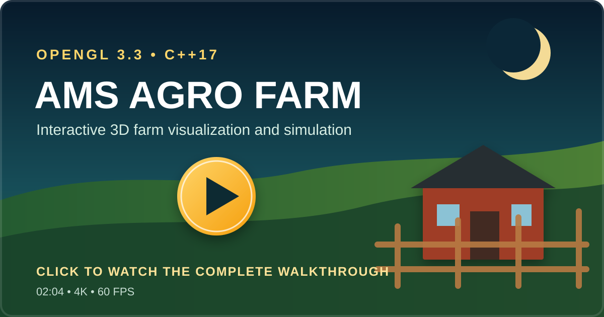

<div align="center">

# AMS Agro Farm

### Interactive 3D Agro-Farm Visualization in Modern OpenGL

An explorable farm simulation featuring animated livestock, controllable farm
work, a wide countryside around the fenced farm, collision-aware navigation,
textured procedural geometry, independent lighting, day/night behavior, and
multiple technical camera views.


</div>

## Project Demo

<div align="center">
  <a href="https://drive.google.com/file/d/1EMApkfHGZpR_ZDTFk81WqK6BsHAgqDNJ/view?usp=sharing">
    
  </a>
  <br>
  <strong><a href="https://drive.google.com/file/d/1EMApkfHGZpR_ZDTFk81WqK6BsHAgqDNJ/view?usp=sharing">▶ Watch the complete project </a></strong>
  <br>
  <sub>Full project video hosted on Google Drive</sub>
</div>

## Overview

AMS Agro Farm is a real-time graphics project developed for **CSE 4102 —
Computer Graphics and Image Processing Laboratory**.

The farm contains a Holstein milking cow, a Brahman-type ox, two calves,
chickens, ducks, a nesting hen with chicks, and a worker who can be controlled
directly or sent on a complete hay delivery task. Animal and worker routines
respond to user commands and the active time of day.

## Key Features

| Area | Implementation |
|---|---|
| Environment | A 1,400-unit-radius circular countryside with continuous rolling hills, gentle distant curvature, groves and day/night distance haze; the farm, nearby fields and movement area remain flat |
| Livestock | One milking cow, one ox, two calves, poultry, nesting hen and chicks; cattle use sculpted back/belly profiles, integrated shoulder anatomy, shorter/broader head meshes and on-skin coat markings |
| Animation | Hierarchical body joints, walking, grazing, tails, worker tasks, rotating fans, gates, shelter routines and an orbiting inspection drone |
| Farm logic | Calf routes, manual or automatic worker hay delivery, daytime roaming and automatic night sheltering |
| Lighting | Switchable Phong/Gouraud shading, directional sunlight, five fixed point lights, a moving inspection light, an aimable/sweeping spotlight and independent controls |
| Ray tracing | Optional real-time analytic farm view with ray/object intersections, hard shadows and one reflection bounce |
| Navigation | Free-look camera with swept collision against gates, walls, fences, trees, stalls and equipment |
| Camera modes | Perspective exploration, bird's-eye view and four simultaneous perspective/orthographic views |
| Curved geometry | Bézier surface-of-revolution milk can, B-spline irrigation pipe, sampled ruled shed roof and Catmull-Rom cattle torso/head/neck profiles |

## Graphics Techniques

- Modern OpenGL 3.3 Core Profile with reusable VAO, VBO and EBO meshes
- Model, view and projection transformations using GLM
- Per-fragment Phong ambient, diffuse and specular lighting
- Selectable per-vertex Gouraud ambient, diffuse and specular lighting
- GPU fragment-shader ray tracing with primary rays, shadow rays and reflective secondary rays
- Multiple independently controlled light sources with emissive fixtures
- A moving point light that follows the inspection drone, plus automatic or manual spotlight aiming
- Indexed procedural meshes with positions, normals and UV coordinates
- Texture mapping with mipmaps and multiple wrapping modes
- Hierarchical modeling with local joint pivots
- Delta-time animation independent of frame rate
- Cubic Bézier and uniform cubic B-spline surface generation
- Perspective and orthographic multi-viewport rendering
- Swept camera collision to prevent tunneling through thin obstacles

## Build and Run

### Guided full-project simulation

Run `powershell -NoProfile -ExecutionPolicy Bypass -File .\run_simulation.ps1`, or choose **Run AMS Agro Farm Guided Simulation** in VS Code's Run Task menu.

The 164-second automatic tour in `src/simulation.cpp` uses the existing farm and animation modules. It shows the countryside, entrance, cattle, calves/poultry, buildings, curved geometry, a complete farmer hay delivery, Gouraud shading, night/moving lights, the separate analytic ray-tracing preview, four views and a final overview. On-screen captions and a progress bar explain each chapter. The ray-tracing chapter is labelled as simplified analytic geometry, not the full raster meshes.

Space pauses/resumes, R restarts, +/- changes speed (0.25x--4x), and Escape exits. After the tour, live farm animations continue. Normal interactive mode is unchanged. An already built executable can also be started with `--simulation`. Use `--simulation-test` for the hidden full-timeline render and worker-flow check.

### Requirements

- Windows 10 or Windows 11
- MinGW GCC installed at `C:\MinGW`
- Visual Studio Code with the Microsoft C/C++ extension, or Visual Studio 2022
- The supplied `CSE 4208 - Graphics` folder beside `ams_agro_farm`


The project already includes the MinGW GLFW import library and runtime DLL.
GLAD, GLFW headers, GLM and `stb_image` are referenced from the course folder.

### VS Code

1. Open the `ams_agro_farm` folder in VS Code.
2. Open `src/main.cpp`.
3. Click the **Run** triangle in the upper-right corner.

The shared VS Code task calls `run_project.ps1`, compiles every source file and
launches the complete application. It does not attempt an invalid single-file
build of `src/main.cpp`.

### PowerShell

```powershell
powershell -NoProfile -ExecutionPolicy Bypass -File .\run_project.ps1
```

Build without launching:

```powershell
powershell -NoProfile -ExecutionPolicy Bypass -File .\run_project.ps1 -BuildOnly
```

After building, check all render modes in a hidden window:

```powershell
.\bin\MinGW\AMSAgroFarm.exe --smoke-test
```

### Visual Studio 2022

1. Open `AMSAgroFarm.sln`.
2. Select `Debug | x64`.
3. Choose **Build Solution**, then **Start Without Debugging**.

## Controls

### Camera and Views

| Input | Action |
|---|---|
| `W` `A` `S` `D` | Move forward, left, backward and right |
| Mouse | Look around |
| `Tab` | Release or recapture the mouse cursor |
| `F1` | Print the complete control reference in the terminal |
| `Q` / `E` | Move down / up |
| Mouse wheel | Zoom |
| `B` | Toggle bird's-eye view |
| `V` | Toggle four-viewport mode |
| `X` | Toggle the real-time ray-traced farm view |
| `Y` | Switch the raster view between Phong and Gouraud shading |
| `F2` | Control the worker with a following camera, or return to free camera |

### Farm Interaction

| Input | Action |
|---|---|
| `G` | Open or close the main farm gate |
| `O` | Open or close both rear cattle-stall gates |
| `T` | Enable or disable texture sampling |
| `F` | Pause or resume the cattle-shed fans |
| `M` | Send the worker from his house to fetch hay, place it at the cow trough, and return home |
| `K` | Send the worker directly home |
| `F2` | Enter or leave direct worker control |
| `W` / `S` in worker mode | Walk the worker forward / backward |
| `A` / `D` in worker mode | Turn the worker left / right |
| `E` in worker mode | Pick up hay beside the stack; place it near the cow trough |
| `L` | Recall or release all mobile animals |
| `J` | Release or return both calves through the ox-side door |
| `N` | Send both calves through the ox-side door to their fodder mats |

### Animal Animation

| Input | Action |
|---|---|
| `C` | Pause or resume adult-cattle animation |
| `R` | Pause or resume all calf movement, including commanded routes |
| `H` | Pause or resume cattle head movement |

### Lighting

Number-row and numpad keys are both supported.

| Input | Action |
|---|---|
| `1` / `Numpad 1` | Directional sunlight on/off |
| `2` / `Numpad 2` | All point-light groups on/off |
| `3` / `Numpad 3` | Entrance spotlight on/off |
| `F3` | Moving inspection drone lamp on/off |
| `F4` | Automatic entrance spotlight sweep on/off |
| `F5` | Pause/resume the moving lamp's flight |
| Arrow keys | Aim the entrance spotlight manually; manual aiming stops automatic sweep |
| `4` / `Numpad 4` | Day/night mode |
| `5` / `Numpad 5` | Ambient component on/off |
| `6` / `Numpad 6` | Diffuse component on/off |
| `7` / `Numpad 7` | Specular component on/off |
| `8` / `Numpad 8` | Shed and farm-building lights on/off |
| `9` / `Numpad 9` | Boundary-fence globe lamps on/off |
| `0` / `Numpad 0` | Entrance-banner light on/off |
| `P` | Owner-billboard light on/off |
| `Esc` | Exit the application |

## System Behavior

- The two adult cattle remain tied in separate indoor stalls with fodder in front.
- `O` opens real rear inspection routes; moving gates pause if the viewer blocks them.
- Calves use the dedicated door beside the ox and never cross the front troughs.
- `J` controls field release/return; `N` sends calves to separate indoor fodder mats.
- The worker starts inside his house. `M` opens the door and starts a full route
  to the hay stacks, lifts a visible hay bundle onto his head, carries it to
  the milking cow's trough, deposits it, and walks home. The delivered hay
  remains visible in the trough.
- `F2` lets you walk the worker yourself. Approach the east side of the hay
  stack near `(-4.1, 3.4)` and press `E` to collect hay. Walk to the front of
  the milking cow's trough near `(-12.0, -3.8)` and press `E` to deliver it.
- The surrounding terrain extends well beyond the original farm boundary;
  the fenced farm remains a distinct site inside crop fields and tree lines.
- During daytime, released calves and poultry move through the open farm areas.
- At night, mobile animals return to their shelters, calves are tied, and work/release
  commands are locked until daytime; the worker can still be sent home with `K`.
- Independent light states remain controllable in both day and night modes.
- Press `4` for night, `F3` for the moving cyan inspection light and `F4` for
  the sweeping entrance spotlight. The moving fixture and its point-light
  position share the same path. The spotlight housing follows its light
  direction in both automatic and manual modes.
- Ray tracing (`X`) renders an analytic preview of the main buildings, entrance,
  metal tank, trees, worker, delivered hay and moving lamp, with shadow rays and
  one reflective bounce. This preview uses simplified shapes; the complete
  textured scene, animal rigs and curve meshes use the raster modes.
- The window title always reports the active view, time of day and fixture states.
- Gate, door, fence, wall and obstacle collision states remain synchronized with animation.

## Source Architecture

For a teacher-friendly item-by-item index, open [CODE_MAP.md](CODE_MAP.md).

```text
src/
├── items/       Ground, gate, sheds, house, trees, hay, lights and props
├── animals/     Cow, calf, poultry and farmer models + behaviour
├── curves/      Milk can, irrigation pipe and curved roof
└── *.cpp        Scene coordinators, main loop and shared rendering systems
include/
├── animals/     Item state/data declarations
├── shared/      Reusable colours, transforms and curve vertex helper
└── *.h          Shared system and renderer declarations
shaders/         Phong, Gouraud and analytic ray-tracing shaders
textures/        Farm texture assets
```

Each item file keeps the original coordinates, dimensions, transformations and behaviour. The scene and animation coordinators now call these modules instead of holding every item implementation in one large file. The MinGW script discovers `.cpp` files recursively; the Visual Studio project and filters list every module explicitly.

## Project Identity

- **Project:** AMS Agro Farm
- **Farm owner displayed in scene:** Md. Shahporan
- **Course:** CSE 4102 — Computer Graphics and Image Processing Laboratory
- **Language:** C++17
- **Graphics API:** OpenGL 3.3 Core Profile

---

<div align="center">
  <strong>AMS Agro Farm</strong><br>
  A complete interactive computer-graphics farm environment.
</div>
